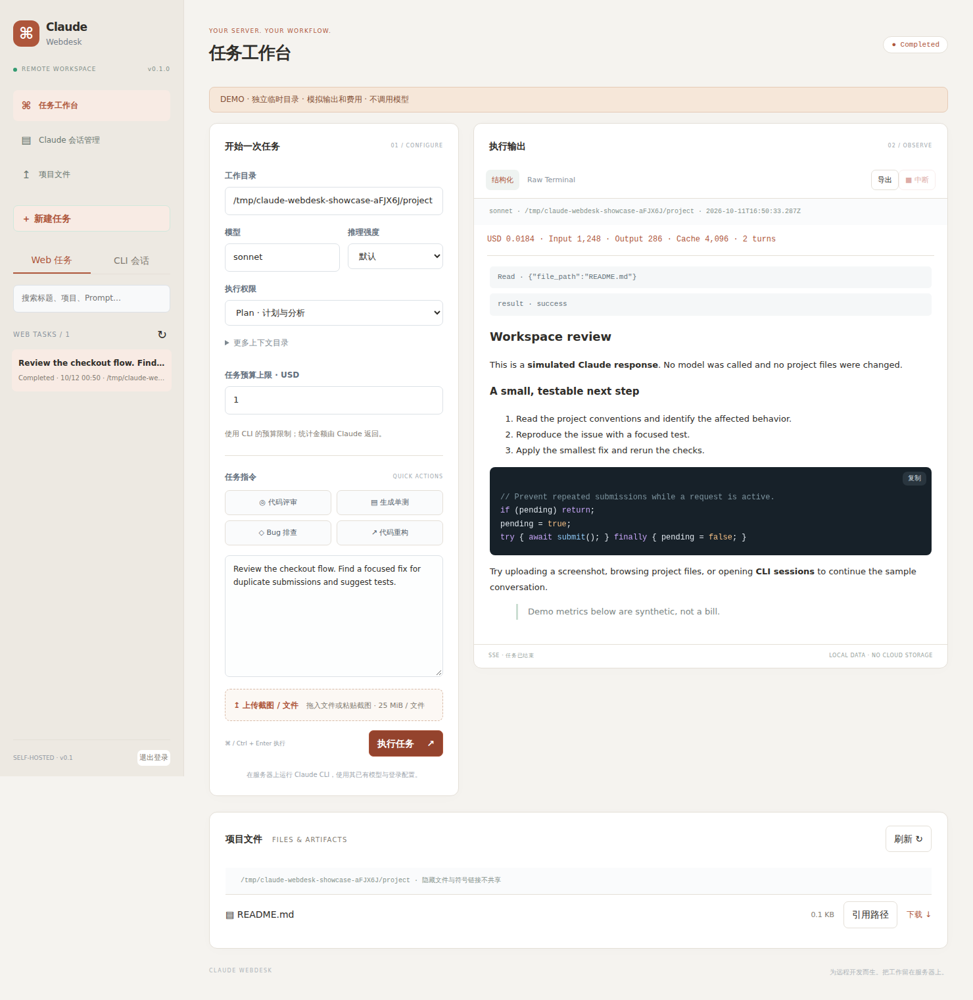

# Claude Webdesk

**把远程服务器上的 Claude Code，变成浏览器里的工作台。**

任务执行、截图上传、历史续聊、费用查看、产物下载，一个页面完成。自托管、单端口、MIT 开源。

[English](../README.md) · [部署](deployment.md) · [插件](plugins.md) · [贡献](../CONTRIBUTING.md)



## 先试用，不调用模型

```bash
npx claude-webdesk demo
# 或 uvx claude-webdesk demo
```

打开终端打印的登录链接。演示使用独立临时目录、示例会话与模拟响应，不需要安装 Claude、不需要 API Key、不产生模型调用费用。上传和历史保存在打印出的临时目录，体验后可自行清理。两种安装方式均需要 Node.js 22+。

## 真实使用

在已经安装、登录 Claude Code 的服务器上运行：

```bash
npx claude-webdesk --cwd /绝对路径/你的项目
```

在本地电脑建立隧道：

```bash
ssh -N -L 8090:127.0.0.1:8090 user@你的服务器
```

访问 `http://127.0.0.1:8090`，输入启动时的访问 Token。默认仅监听本机，公网访问使用 HTTPS 反向代理，见[部署指南](deployment.md)。

长期安装：

```bash
npm install -g claude-webdesk
claude-webdesk doctor
claude-webdesk --cwd /srv/my-project

# Python 渠道（仍需要 Node.js 22+）
uv tool install claude-webdesk
# 或 pip install claude-webdesk
```

固定登录 Token：

```bash
export CLAUDE_WEBDESK_TOKEN="$(openssl rand -hex 32)"
claude-webdesk --cwd /srv/my-project
```

## 已实现

- **浏览器执行 Claude**：多行指令、快捷任务、自定义模型与推理强度、Markdown/代码高亮、Raw Terminal、Ctrl/Cmd + Enter。
- **刷新后接着看**：SSE 实时输出和重连，任务在服务器运行，Web 历史持久化；可中断整个任务进程组。
- **截图直接给 agent**：粘贴截图、拖拽/选择文件，上传进度，路径自动插入 Prompt。单文件 25 MiB，保存到启动项目的 `webdesk-uploads/`，唯一名称避免覆盖。
- **把成果拿回来**：浏览启动目录、引用文件路径、下载产物；隐藏文件、密钥扩展名、符号链接和依赖目录不共享。
- **历史续聊与分叉**：读取原生 `~/.claude/projects/`，回到原项目目录继续；可勾选分叉为新会话。
- **费用可见**：CLI 返回的 USD、输入/输出/缓存 Token、轮数和可选预算限制。金额是 CLI 报告值，不代表订阅账单。
- **会话管理**：全文搜索、项目筛选、HTML/Markdown/JSON 导出、回收站删除、多会话交接。删除运行中的会话会被拒绝。
- **工具扩展**：独立页面/API 插件共用端口和登录，附服务器概览示例。
- **演示与自检**：`demo` 独立体验；`doctor` 检查 Node、Claude 参数能力和可选 Python，不调用模型。

## 权限不是沙箱

默认 **Plan** 模式。可切换 **Accept edits**（文件编辑自动批准）或 **Don't ask**（仅使用已允许的工具）。程序传入 `--permission-prompts none`，无法获取审批的工具操作由 Claude 拒绝，返回的权限拒绝会显示在页面。没有绕过权限的开关，也没有 Web 审批交互。

Claude 沿用服务器上的配置、登录、hooks 与工具，以当前系统用户运行。权限模式和 `--workspace-root` **都不是操作系统级隔离**；后者只约束可选择的任务目录和附加目录。仅对可信项目使用。

## 配置与要求

- Node.js **22+**；完整会话管理还需要 **Python 3.10+**。
- 已核实 CLI 参数的版本：**Claude Code 2.1.296**。其他版本运行 `doctor` 检查。
- Linux 已测试，macOS 进程行为及 Windows 未验证。
- 默认端口 `8090`；任务数据 `~/.local/share/claude-webdesk`；插件 `~/.config/claude-webdesk/plugins`。
- `--claude-home` 指定 Claude 配置目录，默认 `$CLAUDE_CONFIG_DIR` 或 `~/.claude`。
- `--cwd` 同时决定默认任务目录与文件浏览根目录；页面更改任务目录不会更改文件浏览根目录。
- `--max-budget-usd` 的执行与计费统计由 Claude CLI 负责。

完整参数见 `claude-webdesk --help`、[配置示例](../config.example.json) 和 [English README](../README.md#configuration)。

## 当前边界

单用户、一次一个任务，无任务队列/多人隔离。关闭浏览器不会停任务；服务重启会中断，历史标记为 interrupted，不自动重跑。任务输出有保留上限，历史文件总量不自动清理。原生会话暂未做索引，大量记录时扫描会变慢。测试使用模拟 CLI，尚未执行真实付费模型端到端测试。

这次保留了 [codex-webdesk](https://github.com/chao5go/codex-webdesk) 的任务与插件基础，迁入原有 Claude 历史工具，并吸收 [remote-fileshare](https://github.com/chao5go/remote-fileshare) 的截图传输流程。大文件/文件夹、断点续传仍适合用 remote-fileshare。

如果这个工具让你少切几次 SSH，欢迎 Star。也欢迎提交真实使用场景和问题，见[贡献指南](../CONTRIBUTING.md)。独立社区项目，与 Anthropic 无隶属关系。MIT 许可证。
